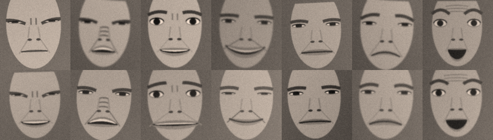

# Handwriting Neural Nets

**Can you write the weights of a facial-expression classifier by hand?**

This repository holds three attempts at 7-class emotion recognition, each of which starts from a different amount of data:

1. **Zero-shot, every weight typed by hand.** A small CNN whose filters are drawn as literal number grids.
2. **Zero-shot, ResNet-50 backbone + hand-typed head.** A frozen ImageNet network, read by probing it with cartoon faces.
3. **Few-shot, 10 real images per class.** The same backbone, with a head set by looking at 70 training photos.

Here *zero-shot* means that no real face image was used to set any weight. It isn't the CLIP sense of the word. Each design was frozen before it saw the test split, and each was tested exactly once.

| # | Model | Real images used to set weights | Cartoon check | Test accuracy | **Test balanced accuracy** |
|:-:|---|:-:|:-:|:-:|:-:|
| 1 | Hand-wired CNN | 0 | 86.4% | 18.1% | **19.5%** |
| 2 | ResNet-50 + typed head | 0 | 90.2% clean / 82.1% rough | 17.8% | **18.1%** |
| 3 | ResNet-50 + few-shot head | 70 | – | 24.1% | **34.3%** |
| ref | Weight imprinting (standard few-shot recipe) | 70 | – | 27.2% | **33.0%** |

<sub>Chance balanced accuracy is 14.3%. Always answering "happy" scores 38.6% accuracy but only 14.3% balanced. Every head uses uniform class priors, so balanced accuracy is the fair measure.</sub>

> **The short version:** the hand-built models pass their cartoon tests at 82–90% and then fall to near chance on real photos. The failure is calibration, not detection: thresholds set without real data don't survive real faces. Ten real images per class add about 15 points. A hand-designed head and a fully automatic one end up level.

---

## Contents

- [The data](#the-data)
- [Ground rules](#ground-rules)
- [Experiment 1: every weight by hand](#experiment-1--every-weight-by-hand)
- [Experiment 2: ResNet-50 and a hand-typed head](#experiment-2--resnet-50-and-a-hand-typed-head)
- [Experiment 3: ten pictures per class](#experiment-3--ten-pictures-per-class)
- [Findings](#findings)
- [Caveats](#caveats)
- [Reproducing](#reproducing)
- [Repository layout](#repository-layout)

---

## The data

`dataset/` holds 100×100 RGB face crops, already aligned, in one folder per class.

| Class | Train | Validation | Test |
|---|--:|--:|--:|
| angry | 705 | 81 | 81 |
| disgust | 717 | 80 | 80 |
| fear | 281 | 37 | 37 |
| happy | 4,772 | 592 | 593 |
| neutral | 2,524 | 340 | 340 |
| sad | 1,982 | 239 | 239 |
| surprise | 1,290 | 164 | 165 |
| **total** | **12,271** | **1,533** | **1,535** |

**Where it comes from.** The data is the [RAF-DB face emotion dataset on Kaggle](https://www.kaggle.com/datasets/nishchalchandel/raf-db-face-emotion-dataset), a ready-to-use 80/10/10 split of the Real-world Affective Faces Database ([RAF-DB](http://www.whdeng.cn/raf/model1.html), basic emotions; Li, Deng & Du, CVPR 2017). The file names show how the split was made. RAF-DB's 12,271 training images are kept whole. The validation and test images are both named `test_*_aligned.jpg`, and each folder holds exactly half of RAF-DB's original 3,068-image test set, class by class.

RAF-DB is released for non-commercial research use. The images are not in this repository, and this README shows only cartoons drawn by the code.

**Getting it.** Download the archive from Kaggle and unpack it so that the folders read `dataset/train/<class>/`, `dataset/validation/<class>/` and `dataset/test/<class>/`, using the seven class names below. `dataset/` is git-ignored.

**It is heavily imbalanced.** Happy faces make up 38.6% of the test split and fear only 2.4% (37 images). Plain accuracy rewards guessing "happy". Results here are judged by **balanced accuracy**, the mean of the seven per-class recalls.

### What was looked at, and when

| Data | Experiment 1 | Experiment 2 | Experiment 3 |
|---|---|---|---|
| Folder layout, one image's size | yes | – | – |
| Mean of all training faces, without labels (for face geometry) | yes | (reused zones) | (reused zones) |
| Individual training images | – | – | 70, picked at random ([`shots.txt`](few_shot/shots.txt)) |
| Validation split | never | never | never |
| Test split | one run | one run | one run |

---

## Ground rules

These were agreed before any code was written:

- **Write once, test once.** Debugging happens only on synthetic cartoon faces (and, in experiment 3, the 70 shots). The test split runs once per experiment, the numbers are reported as they come out, and no weight changes afterwards. In experiments 2 and 3, `run_test.py` refuses to run again once `results_test.txt` exists.
- **Uniform class priors.** No head is biased towards the frequent classes.
- **Literal weights.** Every weight file is plain typed numbers. A parser check confirms there are no computed expressions, loops or loaded files.
- **Anything informed by real data is labelled not zero-shot** and lives outside `zero_shot*/`.

---

## Experiment 1: every weight by hand

📁 [`zero_shot/emotion_cnn/`](zero_shot/emotion_cnn/) · weights in [`weights.py`](zero_shot/emotion_cnn/weights.py)

A five-stage network in plain NumPy. Every kernel is written as a picture of the pattern it looks for: positive cells want brightness, negative cells want darkness.

```
ridge_h — a dark horizontal line (brows, eye slits, the lip line)
  [  1,  1,  1,  1,  1 ]
  [  0,  0,  0,  0,  0 ]
  [ -2, -2, -2, -2, -2 ]
  [  0,  0,  0,  0,  0 ]
  [  1,  1,  1,  1,  1 ]
```

1. **Front end.** RGB is converted to gray (ITU-R 601 luma), pooled to 50×50 and standardised against the skin, so that "dark" means darker than the skin.
2. **conv1.** Nine 5×5 filters: ridges in four orientations, a bright band, dark and bright patches, and top and bottom edges. Each zero-sum filter outputs exactly 1.0 on its ideal pattern.
3. **conv2.** Ten part detectors, such as an open-mouth cavity, a row of teeth, an eye slit, a furrow between the brows, nose wrinkles, smile ends, frown ends and an arched brow.
4. **Action units.** Eleven FACS action units (AUs), each read from hand-placed face zones. The zones follow the label-free mean face: brows on rows 12–14 of 50, eyes on 15–18, lip line on 35–37.
5. **fc layer.** An 11×7 table based on EMFACS, the standard FACS recipes for which action units make up each emotion. Neutral wins only when every unit is quiet.

That's 2,617 numbers in all, 229 of them nonzero convolution weights.

<p align="center">
  <br>
  <sub>The only faces experiment 1 was debugged on. Columns: angry, disgust, fear, happy, neutral, sad, surprise.</sub>
</p>

**Result.** 86.4% on cartoon faces, then **19.5% balanced on the real test split**. Disgust swallowed the predictions: 746 of the 1,535 test faces were called disgust, and five of the seven classes had recall under 10%.

---

## Experiment 2: ResNet-50 and a hand-typed head

📁 [`zero_shot_resnet/`](zero_shot_resnet/) · weights in [`head_weights.py`](zero_shot_resnet/head_weights.py) · probe in [`probe_report.txt`](zero_shot_resnet/probe_report.txt)

The backbone is the ImageNet ResNet-50 from torchvision, frozen and cut after its third stage (`layer3`). That leaves 1,024 channels on a 14×14 grid. The channels carry no labels, so before any weight could be typed, the question was what each one responds to.

**Probing with cartoon twins.** v1's face generator draws the same face twice: once at rest, and once with a single facial action switched on, with identical pose, lighting and noise. There are 11 actions and 128 twin pairs per action. Every face is drawn in two photo styles: a clean one and a rough one with bigger pose jitter, harsher light, blur and skin texture. Each channel, pooled over the action's zone, gets a score:

```
score = min(d′_clean, d′_rough) − max(cross-talk, 0) − shift / 2
```

- **d′** measures how cleanly the channel separates active faces from resting ones (the difference in means divided by the spread).
- **cross-talk** is the strongest response the same channel gives to any other action.
- **shift** is how far the channel's resting level moves between the two photo styles.

**The head.** For each action unit I typed the four best channels, skipping any that failed the cross-talk, shift or gain rules. Each channel comes with its resting level and gain, giving 44 channels in all. A channel's evidence is about 0 at rest and about 1 when the action is fully on. On top sits v1's EMFACS table, unchanged, so experiments 1 and 2 differ only in how the action units are detected.

**Result.** 90.2% on clean cartoons and 82.1% on rough ones, then **18.1% balanced on the real test split**.

| Mean action-unit value on real test faces | angry | disgust | fear | happy | neutral | sad | surprise |
|---|:-:|:-:|:-:|:-:|:-:|:-:|:-:|
| mouth open | 0.80 | 0.87 | 0.83 | 0.87 | 0.85 | 0.87 | 0.87 |
| teeth | 0.63 | 0.64 | 0.71 | 0.69 | 0.52 | 0.56 | 0.53 |
| lip corners up | 0.01 | 0.00 | 0.07 | 0.01 | 0.00 | 0.01 | 0.02 |

The resting levels were measured on cartoon mouths, and a real mouth, with lip texture and shading, sits far above them. So "mouth open" fired on every face, and surprise took 653 of the 1,535 predictions. The smile detector never fired at all, not even on happy faces.

---

## Experiment 3: ten pictures per class

📁 [`few_shot/`](few_shot/) · weights in [`few_shot_weights.py`](few_shot/few_shot_weights.py) · measurements in [`shots_report.txt`](few_shot/shots_report.txt)

> **Not zero-shot.** The head was set from 70 training images: 10 per class, chosen at random with seed 0.

**Looking first.** Contact sheets of the shots showed three things. The sheets are `figures/shots_*.png`, which `select_shots.py` redraws locally; they aren't committed because they are dataset images.
- The zero-shot zones sit correctly on real aligned faces.
- Open mouths and teeth appear in five of the seven classes, so the mouth on its own says little.
- Eyes and brows carry the distinctions: wide eyes and raised brows for surprise and fear; squeezed eyes for crying, glaring, sneering and smiling.

**Labelling by eye.** Each shot was marked with the facial actions it visibly shows. The letter codes are R brows raised, L brows lowered, W eyes wide, S eyes squeezed, N sneer, U lip corners up, D lip corners down, O mouth open, T teeth. The labels are stored in the weights file as `SHOT_LABELS`. Because actions cut across emotions, each detector learns from far more than 10 examples. "Mouth open", for instance, appears in 31 of the 70 shots.

**The head.**
- **Detectors.** Nine action-unit detectors, each made of the 16 `layer3` channels that best separate shots with the action from shots without it.
- **fc layer.** A **naive-Bayes** table: the log-odds of each action given each emotion, counted from my labels. Absent actions count as evidence too, which is the only way a "nothing is happening" class like neutral can win.

Every number is a typed literal pasted from [`measure_shots.py`](few_shot/measure_shots.py), which also confirms the pasted copy matches its measurements.

| Before the test (70 shots only) | Accuracy |
|---|:-:|
| Fit on the shots themselves (optimistic) | 55.7% |
| **Leave-one-out over the shots** | **38.6%** |
| Same leave-one-out, with my own labels in place of the detectors | 68.6% |

**Result.** **34.3% balanced on the real test split.** That's 15 points above both zero-shot models, and level with the reference. The reference, fixed before the run, imprints each class's weight as the mean ResNet-50 feature of its 10 shots and scored 33.0%.

The detectors now carry over to real faces:

| Mean action-unit value on real test faces | angry | disgust | fear | happy | neutral | sad | surprise |
|---|:-:|:-:|:-:|:-:|:-:|:-:|:-:|
| eyes wide | 0.23 | 0.21 | **0.69** | 0.32 | 0.39 | 0.21 | **0.68** |
| brows lowered | **0.60** | 0.44 | 0.28 | 0.23 | 0.25 | 0.28 | 0.16 |
| lip corners up | 0.17 | 0.27 | 0.19 | **0.51** | 0.24 | 0.21 | 0.10 |
| lip corners down | 0.15 | 0.44 | 0.10 | 0.23 | **0.56** | 0.33 | 0.21 |

The last row shows the main failure. Most shots I labelled "lip corners down" had closed mouths, so that detector learned *closed mouth* and fires hardest on neutral faces. As a result, 164 of the 340 neutral test faces were called disgust.

---

## Findings

**1. Passing a synthetic test says almost nothing about real faces.** Experiments 1 and 2 reached 82–90% on cartoons and 18–20% on photos. Cartoon checks are good at catching wiring mistakes, and no use for estimating real accuracy.

**2. Zero-shot models fail by calibration, not by blindness.** Each zero-shot model had one detector that fired on nearly every real face: disgust in v1, mouth-open in v2. The shapes were right, but the resting levels and thresholds were set on drawings. A single runaway unit is enough to drag every prediction into one class.

**3. Ten real images per class are worth more than all the cartoon engineering.** Going from 0 to 70 real images moved balanced accuracy from about 19% to 34%. The cartoon probing in experiment 2 hand-picked a few channels with care. The few-shot detectors simply used real images, and that mattered more.

**4. A hand-designed head matches the automatic one but doesn't beat it.** The few-shot head (34.3%) and weight imprinting (33.0%) differ by less than their noise of about ±2 points. They do succeed in different places:

| Recall by class (test n) | v1 | v2 | few-shot head | imprinting |
|---|:-:|:-:|:-:|:-:|
| angry (81) | 2.5% | 1.2% | **46.9%** | 32.1% |
| disgust (80) | 56.2% | 15.0% | 55.0% | 56.2% |
| fear (37) | 18.9% | 29.7% | **62.2%** | 45.9% |
| happy (593) | 27.0% | 26.1% | 28.0% | 31.4% |
| neutral (340) | 5.6% | 0.6% | 3.5% | 11.2% |
| sad (239) | 2.5% | 4.6% | 18.0% | 21.8% |
| surprise (165) | 23.6% | 49.1% | 26.7% | 32.7% |

The hand-made head, built from action units, is much better at angry and fear, where the cues are distinctive: lowered brows with bared teeth, and wide eyes with an open mouth. The prototypes do better on neutral, sad and surprise.

**5. Neutral is the hardest class for an interpretable head.** "Nothing is happening" requires every detector to stay quiet at once. Neutral recall never rose above 11.2%, and the one model that reached it was the one with no action units at all.

**6. The mouth is the least informative part of the face.** It is busy in happy, angry, fear, surprise and crying faces alike. In leave-one-out tests on the shots, class averages built from the mouth zone alone scored 17%, against 27–29% for the eye zones.

**7. Naive Bayes made the most of the hand labels.** With the same detectors, a linear table counted from the labels scored 28.6% leave-one-out, while the naive-Bayes log-odds table scored 38.6%. The difference is that naive Bayes also counts the absence of an action as evidence.

---

## Caveats

- **The test split has been used three times,** once per experiment. Each design was frozen before its run, but anything built on these results should be judged on the **validation split**, which no experiment has touched.
- **The few-shot labels are by eye,** from 100×100 crops; some are surely wrong. With 70 shots, the leave-one-out estimate has a standard error of about ±6 points, so the few-shot design choices (channel count, smoothing) were made on noisy evidence.
- **Cartoon faces were drawn by the same person who wired the detectors,** so the cartoon checks test the wiring, not generalisation.
- **Two of experiment 1's figures predate its final weights.** In [`figures/`](zero_shot/emotion_cnn/figures/), `zones.png` shows an older set of zone boxes, and `feature_maps.png` was rendered from the earlier weights. They were left untouched with the rest of v1.
- **Numbers can differ slightly between Apple MPS and CPU** in the ResNet experiments.

---

## Reproducing

Tested with Python 3.10, NumPy 1.26, Pillow 11.3, PyTorch 2.4 and torchvision 0.19. The ImageNet ResNet-50 weights (`IMAGENET1K_V2`, about 100 MB) download on first use. First put the Kaggle data in `dataset/` (see [The data](#the-data)), then run each script from inside its folder.

```bash
pip install numpy pillow torch torchvision
```

**Experiment 1**
```bash
cd zero_shot/emotion_cnn
python check_filters.py     # unit checks: each typed filter on its ideal pattern
python synthetic_faces.py   # cartoon wiring check (86.4%), redraws figures/synthetic_faces.png
python show_features.py     # redraws figures/feature_maps.png and figures/zones.png
# python evaluate.py        # the single test run; already done, see results_test.txt
```

**Experiment 2**
```bash
cd zero_shot_resnet
python probe.py             # cartoon-twin probe, rewrites probe_report.txt
python synthetic_check.py   # cartoon wiring check, both photo styles
python run_test.py          # refuses: results_test.txt already exists
```

**Experiment 3**
```bash
cd few_shot
python select_shots.py      # re-picks the same 70 shots (seed 0) and redraws figures/
python measure_shots.py     # detector table, fc table, leave-one-out estimate
python run_test.py          # refuses: results_test.txt already exists
```

Experiment 1's `evaluate.py` has no rerun guard. Running it again won't change any weight, but it does spend another look at the test split.

---

## Repository layout

```
handwriting-neural-nets/
├── dataset/                    train / validation / test from Kaggle (git-ignored)
├── zero_shot/
│   └── emotion_cnn/            Experiment 1: hand-wired CNN
│       ├── weights.py          every weight, as typed grids and tables
│       ├── model.py            NumPy forward pass
│       ├── synthetic_faces.py  cartoon face generator (reused by 2 and 3)
│       ├── check_filters.py    unit checks for the filters
│       ├── show_features.py    activation and zone figures
│       ├── evaluate.py         one-shot test evaluation
│       ├── results_test.txt
│       └── figures/
├── zero_shot_resnet/           Experiment 2: frozen ResNet-50 + typed head
│   ├── backbone.py             ResNet-50 cut after layer3, gray input
│   ├── cartoon.py              cartoon twins and the rough photo style
│   ├── probe.py                channel ranking → probe_report.txt
│   ├── head_weights.py         the typed head
│   ├── head.py                 forward pass
│   ├── synthetic_check.py      cartoon wiring check → results_synthetic.txt
│   ├── run_test.py             one-shot test evaluation → results_test.txt
│   └── probe_report.txt, results_synthetic.txt, results_test.txt
└── few_shot/                   Experiment 3: 10 shots per class
    ├── select_shots.py         picks the shots → shots.txt, figures/
    ├── few_shot_weights.py     my labels, detectors and naive-Bayes table
    ├── measure_shots.py        measurements → shots_report.txt
    ├── few_shot_head.py        forward pass
    ├── run_test.py             one-shot test (+ imprinting reference) → results_test.txt
    └── shots.txt, shots_report.txt, results_test.txt, figures/ (git-ignored)
```
